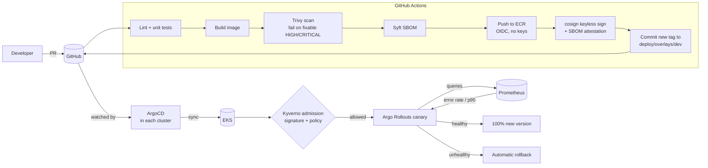
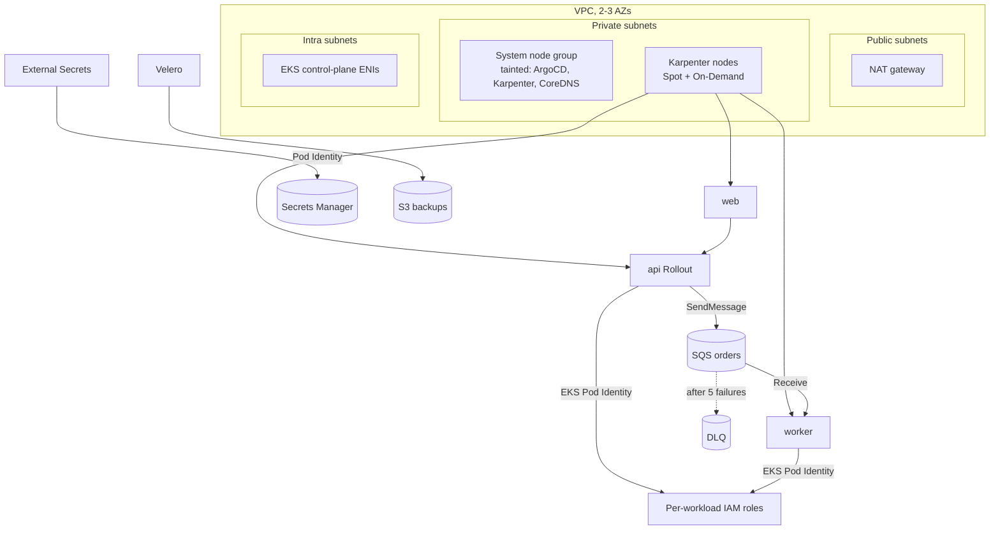

# Architecture

## Delivery path: commit to production

Promotion from dev to stage to prod uses the `promote` workflow. It verifies
the image signature and opens a pull request that copies the image tag to the
next overlay. Prod pull requests need CODEOWNERS approval. After merge,
`record-deployment` writes a GitHub Deployment, which feeds the DORA metrics.

## Runtime: one EKS cluster per environment

### Who owns what

| Layer | Tool | Where |
|---|---|---|
| Network, EKS, IAM, SQS, S3, ECR | Terraform | `infra/terraform` |
| Cluster add-ons | ArgoCD apps (Helm charts) | `platform/addons` |
| Per-cluster values | Kustomize patches | `platform/clusters/<env>` |
| Guardrails | Kyverno policies | `platform/policies` |
| Application manifests | Kustomize base + overlays | `deploy/` |
| Application code | Python / nginx | `apps/` |

### Observability

- **Metrics**: services expose Prometheus metrics, and ServiceMonitors register
  them with kube-prometheus-stack. SLOs are recording rules plus multi-window
  burn-rate alerts (`deploy/base/api/prometheusrule.yaml`).
- **Traces and logs**: services send OTLP to the OpenTelemetry Collector, which
  routes metrics to Prometheus and logs to Loki. It also drops health-check
  spans before export.
- **Delivery**: the DORA exporter turns GitHub deployment and incident records
  into Prometheus metrics, shown on the "DORA Metrics - Production" Grafana
  dashboard.

### Security controls, end to end

| Control | Implementation |
|---|---|
| No long-lived CI credentials | GitHub OIDC to AWS roles scoped by repo, branch and environment |
| Vulnerable images blocked | Trivy fails the build on fixable HIGH/CRITICAL |
| Provenance | cosign keyless signatures plus SBOM attestations in Rekor |
| Only signed images run | Kyverno `verify-image-signatures`, with tags pinned to digests |
| Hardened pods | Kyverno policies plus Pod Security Admission `restricted` on `orders` |
| Least-privilege AWS access | One IAM role per service account (EKS Pod Identity) |
| Secrets stay out of Git and state | External Secrets syncs from Secrets Manager |
| Network segmentation | NetworkPolicies per workload, default deny |
| IaC misconfiguration | Checkov and tflint on every PR, with justified skips inline |
| Supply chain of CI itself | Every GitHub Action pinned to a commit SHA, updated by Dependabot |
